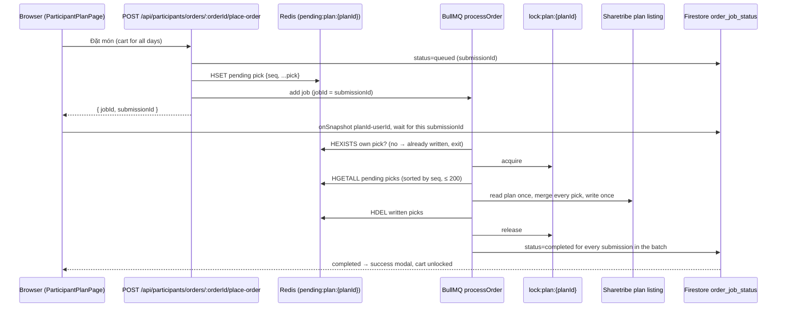

# Participant — Food Selection Flow

## Overview

During the `picking` phase, participants choose their food for each delivery date. Every pick ends up in `plan.metadata.orderDetail[timestamp].memberOrders[userId]`, and Sharetribe can only replace the whole `orderDetail` object, so **every writer of `orderDetail` must run under the Redis plan lock `lock:plan:{planId}`**.

Participant picks are written **asynchronously and in batches**: the API stores the pick in a Redis hash and queues a BullMQ job; whichever job holds the plan lock writes _every_ pick waiting for that plan in one Sharetribe update. A burst of N simultaneous picks costs a few writes instead of N serialized ones.

Admin/booker/partner/system writes are **synchronous**: the API route wraps its own read-merge-write in `withPlanLock`.

---

## Participant flow



### Entry points

| Endpoint                                                   | Used by                                                        |
| ---------------------------------------------------------- | -------------------------------------------------------------- |
| `POST /api/participants/orders/[orderId]/place-order`      | Plan page "Đặt món" (validates the cart, incl. secondary food) |
| `POST /api/participants/orders/[orderId]` (`index.api.ts`) | Calendar / sub-order edits (`updateParticipantOrderApi`)       |

Both call `enqueueParticipantOrder` (`src/services/jobs/processOrder.job.ts`) and return at once with `{ jobId, submissionId }`. **Never write `orderDetail` from these routes.**

Both first refuse with **400** when `getParticipantPickClosedReason(order)` (`src/helpers/orderHelper.ts`) returns a reason: the order is no longer `picking`, or `metadata.deadlineDate` has passed. This is the same rule the participant UI uses to disable picking. It binds participants only; booker/admin edits (`member-order`) are not checked.

### Pending picks in Redis

| Key                     | Type   | Content                                                                                                                |
| ----------------------- | ------ | ---------------------------------------------------------------------------------------------------------------------- |
| `pending:plan:{planId}` | hash   | field `submissionId` → JSON `{ seq, orderId, planId, currentUserId, orderDay?, memberOrders?, orderDays?, planData? }` |
| `pending:seq:{planId}`  | string | `INCR` counter giving each pick its `seq`                                                                              |

- One field per **submission**, not per user: two clicks of one user can cover different days, and both must be applied.
- Picks are applied in `seq` order, so a later pick of the same user wins on a shared day. `seq` comes from Redis, not a clock, because ECS tasks can disagree on the time.
- Both keys expire after 24 h (refreshed on every pick).

### Worker (`processOrder.job.ts`)

- Queue `processOrder`, concurrency 5 per process, 3 attempts with exponential backoff (2 s base), job `delay` 500 ms (also the window in which a burst gathers into one batch).
- Job data carries `pending: true` plus the pick itself, so a pre-batching worker still alive during a rolling deploy writes it the old way. A job **without** `pending` was queued by such a worker; the new worker first moves its pick into the hash (`HSETNX`).
- A job whose pick is no longer in the hash exits without taking the lock (another batch wrote it).
- Inside the lock: `HGETALL` → sort by `seq` → read order + plan → `mergeParticipantOrder` per pick → one `listings.update` → `HDEL` the batch.
- The order is re-checked with `getParticipantPickClosedReason` **under the lock**. `start-order` moves the order to `inProgress` before `initiate-transaction` takes the plan lock, so a batch that reaches the lock after the order started (or after the deadline) is refused whole: every pick `failed` with the reason, plan untouched, no Slack alert.
- A pick whose merge throws is dropped from the batch and marked `failed` alone. Users who are neither `participants` nor `anonymous` are added to `order.metadata.anonymous` once per batch.
- **Retry** (attempt ≥ 2) writes only the job's own pick, so a pick Sharetribe rejects cannot keep failing every batch it lands in.
- **Final failure** (`worker.on('failed')`, last attempt): `HDEL` the job's own pick. `1` → the pick was never written: status `failed` + one Slack alert. `0` → another batch already wrote it: no failure reported.
- After the lock is released: Firestore statuses, then `verifyOrderPersistence` for every written pick (Slack on mismatch).

Measured on `pito-dev` (local `next dev`, 1 worker): 51 participants clicking within the same second → **1** plan write (`written: 51`, 3.7 s), every user `completed` within 10 s, 250/250 picks persisted.

### Participant UI

- `runParticipantOrderJob` (`src/redux/slices/ParticipantOrderJob.slice.ts`) calls the API, then `waitForOrderJobStatus` (`src/helpers/orderJobStatus.ts`) listens on `order_job_status/{planId}-{userId}` for the submission's `completed`/`failed` (timeout 120 s). It returns `jobStatus: 'completed' | 'timeout'` and throws on `failed`.
- Plan page (`ParticipantPlanPage.slice.ts → placeOrder`):
  - `submitDataInprogress` is the single busy flag: the "Đặt món" button shows "Đang xử lý, vui lòng đợi" with a spinner, and "Xoá toàn bộ giỏ hàng", "Chọn giúp tôi", "Chọn giúp tôi cả tuần", "Bỏ chọn ngày này", the cart's change/remove icons and the dish cards are disabled.
  - `completed`: the job wrote exactly this cart, so the loaded plan is patched locally (`applyOwnMemberOrders`) instead of reloading it. `timeout`: the outcome is unknown, so `reloadData` refetches the plan.
  - The Firestore sub-order history documents (`participantSubOrderAddDocumentApi`, one per day) start after the job succeeded but are not awaited.
- Calendar (`OrderEventCardStatus`) shows "Đang xử lý, vui lòng đợi" per date via `useIsSubOrderProcessing` while a pick for that date is in flight.

The status doc is one per user per plan, keyed `planId-userId`. If a second submission overwrites it before the UI saw the first one's `completed`, the first waiter falls back to its 120 s timeout (data is still correct).

---

## Admin / booker / partner / system writes

`withPlanLock(planId, criticalSection)` (`src/services/distributedLock.ts`) takes the same `lock:plan:{planId}` (TTL 30 s, ~11 s of retries, then it throws). Keep the critical section to fetch + merge + update; never await a job or another plan lock inside it (nesting throws).

Writers using it:

| File                                                                                                                                   | Write                                                                      |
| -------------------------------------------------------------------------------------------------------------------------------------- | -------------------------------------------------------------------------- |
| `api/orders/[orderId]/member-order/index.api.ts`                                                                                       | Admin/booker edits a member's pick (values are patches on the fresh pick)  |
| `api/orders/[orderId]/participant/index.api.ts`                                                                                        | Add / remove participants                                                  |
| `api/orders/[orderId]/plan/update.service.ts`                                                                                          | Plan edits (`patchSubOrders`: never takes `memberOrders` from the client)  |
| `api/orders/[orderId]/update-order-detail-from-draft.api.ts`                                                                           | Admin order edit from draft                                                |
| `api/helpers/foodHelpers.ts`                                                                                                           | Food list changes                                                          |
| `api/orders/[orderId]/publish-order.service.ts`, `request-approval-order.api.ts`                                                       | Order lifecycle                                                            |
| `api/orders/[orderId]/plan/[planId]/initiate-transaction.service.ts`                                                                   | `transactionId` per date                                                   |
| `api/admin/plan/transit.api.ts`, `api/partner/[partnerId]/orders/[orderId]/transit.api.ts`                                             | `lastTransition`                                                           |
| `api/admin/payment/confirm-partner-payment.api.ts`, `disapprove-partner-payment.api.ts`                                                | `isAdminPaymentConfirmed` (check + Firebase record + write under the lock) |
| `api/admin/payment/transition-order-payment-status.api.ts`                                                                             | `isPaid` (payment records read before the lock)                            |
| `api/webhook/onwheel/index.api.ts`                                                                                                     | `isOnWheelOrderCreated`, `trackingLink`, `lastTransition`                  |
| `api/apiServices/company/addMembersToCompanyFn.service.ts`                                                                             | New company members added to open group orders                             |
| `api/participants/orders/[orderId]/update-first-time-view-order.api.ts`, `api/participants/plans/recommend-food-for-sub-orders.api.ts` | Participant-side system writes                                             |

Merge helpers (`src/helpers/order/orderDetailHelper.ts`):

- `keepServerOwnedSubOrderFields` — a client-built orderDetail never rolls back `transactionId`, `lastTransition`, `isPaid`, nor un-cancels a date.
- `patchSubOrders` / `clearPicksOutsideFoodList` — a restaurant change clears only the fresh picks the new food list no longer offers.
- `getPicksClearedByEdit` — lists those picks so the admin is warned before saving.

---

## Failure alerting

`PARTICIPANT_ORDER_PERSISTENCE_FAILED` → `SLACK_WEBHOOK_FOR_MISSING_ORDERS_URL`:

- `failedAt: 'job-exception'` — a pick given up after the last attempt (one alert per pick).
- `failedAt: 'merge-rejected'` — picks dropped from a batch because their merge threw.
- `verify-after-release` mismatches from `verifyOrderPersistence`.

This channel is the only observable signal for silent data loss — check it after any change to this flow.

---

## Participant removal & orderDetail cleanup

When a participant is deleted from an order (`DELETE /api/orders/[orderId]/participant`), their picks are removed from all dates with `removeParticipantFromOrderDetail(orderDetail, participantId)` (`src/utils/order.ts`), under `withPlanLock`.

---

## Auto-pick food

If `order.metadata.isAutoPickFood === true`, an AWS EventBridge scheduler fires at the selection deadline and the Lambda `PICK_FOOD_FOR_EMPTY_MEMBER_LAMBDA_ARN` picks food for empty slots via the Integration SDK. **It runs outside this repository and does not take the plan lock.**

---

## Data storage

```
plan.metadata.orderDetail = {
  "1711929600000": {              // delivery date, ms
    "restaurant": { id, restaurantName, foodList: { [foodId]: { foodName, foodPrice, numberOfMainDishes, ... } } },
    "memberOrders": {
      "userId-123": {
        "status": "joined",       // joined | notJoined | empty
        "foodId": "food-listing-id",
        "requirement": "No spicy",
        "secondaryFoodId": "...", // companies in NEXT_PUBLIC_SECONDARY_FOOD_ALLOWED_COMPANIES
        "secondaryRequirement": ""
      }
    },
    "transactionId": null,        // set by initiate-transaction
    "lastTransition": null
  }
}
```

---

## Known issues / watch points

1. **Legacy Firestore path** — `NEXT_PUBLIC_FIREBASE_MEMBER_ORDERS_COLLECTION_NAME` is drained by the external `updateMemberOrders` Lambda, which writes plans **without** the lock. Nothing in this repo writes to it any more; `api/participants/plans/[planId]` still reads its `pending` docs. Retire the Lambda once the collection is empty.
2. **`processMemberOrder.job.ts` is dead code** using the same queue name `processOrder`. Importing it would start a second worker competing for jobs. Delete it.
3. **`place-order` latency** dominates under load (≈ 6.4 s p50 with 50 simultaneous requests on `next dev`): the route reads order and plan sequentially and makes several Upstash round-trips.
4. **Sub-order history documents** are created in the background after success; closing the tab within ~2 s can skip them.
